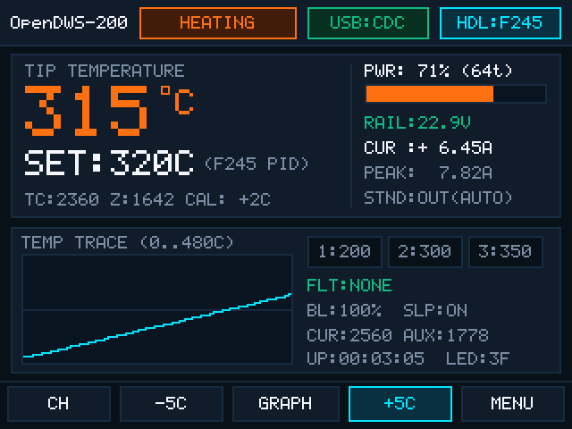
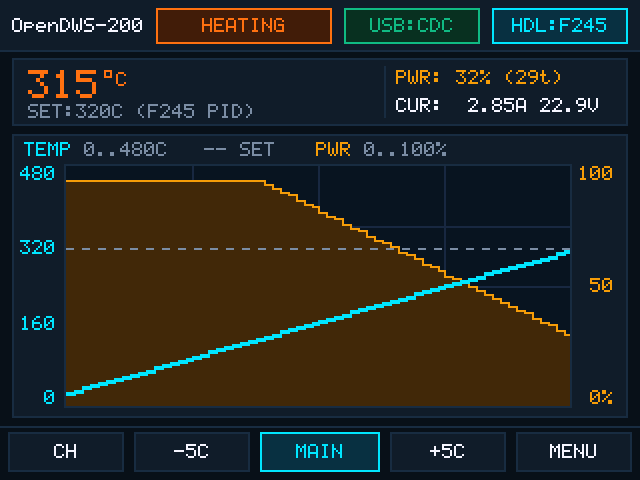
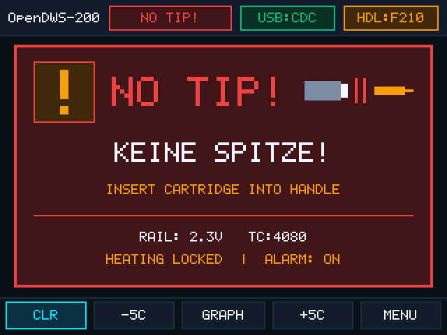

# OpenDWS-200 ⚡🪛

[](https://github.com/Daddelgreis74/OpenDWS-200/actions/workflows/build-and-release.yml)
[](LICENSE)

Alternative **Open-Source Bare-Metal-Firmware** für die **FNIRSI DWS-200** 200-W-Präzisionslötstation (MCU: Artery `AT32F415RCT7`, ARM Cortex-M4 ohne FPU, `144 MHz`).

> [!IMPORTANT]
> **Phase 2 — Geschlossene PID-Regelung, Auto-Off-Timer & flimmerfreie UI (`v0.2.7-phase2`)**
> Nach dem Einschalten fährt die Station (sofern der Kolben im Ständer ruht und eine Spitze steckt) automatisch in den ruhigen **Vollbild-Standby (`100 °C` Vorheizen + Auto-Off-Countdown)** und wartet auf die Entnahme des Kolbens (`PB5`). Fehlt die Spitze (`PC0 > 4000`), erscheint automatisch die grafische **`NO TIP! / KEINE SPITZE!`**-Warnung mit wiederkehrendem Signalton (`1,5 s`), und Heizen bleibt strikt gesperrt. Der **Power-Button (`PB0`/`PB1`)** speichert geänderte Settings und schaltet sauber ab.

---

## 📸 UI-Vorschau (Screenshots)

| Vollbild-Standby (`100 °C` & Auto-Off) | Aktives Heizen (`F245 PID`) |
| :---: | :---: |
|  |  |

| Temperatur- & Leistungsdiagramm (`GRAPH`) | On-Screen-Einstellungsmenü (`PB4`) |
| :---: | :---: |
|  |  |

| Grafische `NO TIP!`-Warnung + Alarmton | |
| :---: | :---: |
|  | |

---

## 🌟 Features (`v0.2.7-phase2`)

- **⚡ Originalgetreuer Auto-Ständer (`PB5`), Standby-Schirm & Auto-Off-Schutz:**
  - **Boot-Standby & Vorheizen:** Start im Ständer (`PB5 = LOW`) heizt nach dem `455-µs`-Prüfpuls auf `100 °C` vor und zeigt den ruhigen Vollbild-Standby-Schirm (`Standby Screen` im Menü abschaltbar). Entnahme aus dem Ständer (`PB5: LOW→HIGH`) startet automatisch die volle Solltemperatur; Boot außerhalb des Ständers bleibt sicher auf `0 W`.
  - **Konfigurierbarer Auto-Off-Timer (`OFF`, `5 / 10 / 15 / 30 / 60 min`, Standard `10 min`):** Schaltet die Spitze nach längerer Ruhe im Ständer komplett stromlos (`0 W`) mit Live-Countdown und Signalton, um Spitzenoxidation zu minimieren. Beim Herausnehmen aus dem Ständer heizt sie sofort wieder auf.
  - **`READY`-Signalton (`100 ms`):** Ertönt einmalig beim Erreichen der Solltemperatur (`±3,0 °C`), ohne beim Löten erneut zu piepen (respektiert `Buzzer: ON/OFF`).
  - **Grafischer `NO TIP! / KEINE SPITZE!`-Warnbildschirm:** Erscheint automatisch bei fehlender Spitze (`FAULT_OPEN_TIP`, `PC0 > 4000`) mit alle `1,5 s` wiederkehrendem Signalton.
  - **Soft-Power-Latch (`PB0`/`PB1`):** Speichert geänderte Einstellungen automatisch im Flash (`0x0803F800`) und schaltet über `PB1 = LOW` sauber ab.

- **🖥️ Flimmerfreie Aurora-Dark Löt-UI (`320 × 240`, ST7789V) & Diagramm-Ansicht:**
  - **Flimmerfreie Darstellung:** Single-Pass-Streifenpuffer (`gfx_draw_badge` / Sparkline / Dual-Graph) mit `10 Hz`-Refresh ohne sichtbares Löschen/Neuzeichen.
  - **Duales Temperatur- & Leistungsdiagramm (`GRAPH`):** Per `MODE/OK` (`PD2`) umschaltbar — zeigt live Temperaturverlauf (`0..480 °C`), Leistung (`0..100 %`) und Sollwert-Linie (`-- SET`).
  - **On-Screen-Einstellungsmenü (`PB4`):** Sleep Temp (`OFF` / `50–250 °C`, Standard `100 °C`), Auto Stand `ON/OFF`, **Standby Screen `ON/OFF`**, **Auto Off (`OFF` / `5–60 min`, Standard `10 min`)**, Presets `CH1..3`, Spitzenkalibrierung (`Cal F245/F210`), Backlight (`10–100 %`), Buzzer `ON/OFF`, USB Stream `ON/OFF` und `Save to Flash`.

### Tastenbelegung (v. l. n. r.)

| Taste | Pin | Haupt- / Standby-Ansicht | Im Einstellungsmenü (`PB4`) |
| :--- | :--- | :--- | :--- |
| Links (`CH / CLR`) | `PC11` | Presets `200 / 300 / 350 °C` wechseln bzw. Fault löschen | Schritt zurück / Bearbeiten beenden |
| 2. v. l. (`<`) | `PC12` | Sollwert `-5 °C` (Langdruck `-25 °C`) | Hoch scrollen / Wert `-` |
| Mitte (`MODE / OK`) | `PD2` | **Kurz:** Hauptansicht ↔ `GRAPH`-Diagramm<br>**Lang:** Flash speichern (schaltet Heizung **nicht**) | Punkt wählen / Option mit **`OK`** umschalten |
| 4. v. l. (`>`) | `PB3` | Sollwert `+5 °C` (Langdruck `+25 °C`) | Runter scrollen / Wert `+` |
| Rechts (`MENU`) | `PB4` | Einstellungsmenü öffnen | Einstellungsmenü schließen |

- **🔥 `100 Hz` Blanking & `91 µs` PID-Regelung (`TMR1` + `TMR2`):**
  - Verifiziertes DC-Blanking aus `APP_DWS_200_V1.5`: `1,0 ms` nach `PA2 = LOW` misst `PC0` die Thermospannung ohne Heizstrom-Störung (`alpha = 0,2` EMA).
  - Automatische Griff-Erkennung über `PB6` + Backup-Domain Analog-Mux (`PC13..PC15`) inkl. `1,0 s` Einschwing-Sperre:
    - **`F245` (`PB6 = 1`):** `200 W` Profil, `5`-Segment-Kennlinie, max. `80..90` Ticks (`7,3..8,2 ms`), Kurzschluss-Cutoff `10,0 A`.
    - **`F210` (`PB6 = 0`):** `C210`-Kennlinie, hart begrenzt auf max. `30` Ticks (`2,73 ms`), Kurzschluss-Cutoff `15,0 A`.
- **🛡️ Mehrschichtige Sicherheitsarchitektur:**
  - `364 µs` Sofort-Überstromabschaltung im `TMR2`-Interrupt + `455 µs` Prüfpuls bei Erststart und Spitzenwechsel.
  - `24-V`-Schienenüberwachung (`PA3 × 16`), Open-Tip (`> 4000 raw`), `30 s`-Dauerüberlast (`> 5 A`), `480 °C`-Hartlimit, *Thermal Runaway Protection* (`8 s`) und Hardware-Watchdog (`2 s`).
- **🔌 USB-CDC Live-Telemetrie & Fernsteuerung (`VID 0x2E3C / PID 0x5740`):**
  - Vollständiges ASCII-Protokoll (`HELP`, `INFO`, `STAT`, `HEAT`, `TEMP`, `PRESET`, `SLEEP`, `CAL`, `CLEAR`, `SAVE`, `STREAM`, `BL`, `BEEP`, `LED`, `REBOOT`).

---

## 💻 PC-Software (`OpenDWS-200 Studio`)

Im Ordner [`pc-app/`](pc-app/) liegt die **Electron Desktop-App (`OpenDWS-200 Studio`)** im Aurora-Dark-Design mit 3D-App-/Desktop-Icon als **Windows-Installer (`setup.exe`)** sowie **Portable-EXE** (über den gemeinsamen Release-Workflow in [GitHub Releases](../../releases) gebündelt):

- **Direkter Download:** Unter [GitHub Releases](../../releases) (`OpenDWS-200-Studio-*-win-x64-setup.exe` und `OpenDWS-200-Studio-*-win-x64-portable.exe` gemeinsam mit der Firmware-`.bin`).
- **Funktionen:** Automatische USB-Erkennung & Reconnect (`Auto-USB`, `VID 0x2E3C / PID 0x5740`), Live-Temperatur-/Leistungs-/Strom-Plotter, vollständige Fernsteuerung (`TEMP`, `PRESET`, `HEAT`, `SLEEP`, `CAL`, `BL`, `SAVE`), CSV-Export, Raw-USB-Konsole sowie 1-Klick-Firmware-Updater (GitHub-Release oder lokale `.bin` direkt aufs `BOOTLOADER`-Laufwerk mit SHA-256-Prüfung).

---

## 🔌 Flashen & Zurückflashen (ohne Programmer)

1. Lötstation am rückseitigen Netzschalter ausschalten.
2. **MODE-Taste** (`PD2`) gedrückt halten und per **USB-C-Datenkabel** mit dem PC verbinden.
3. Im Windows-Explorer erscheint das Laufwerk `BOOTLOADER`.
4. `APP_DWS_200_OpenDWS-*.bin` (aus den [GitHub Releases](../../releases)) auf `BOOTLOADER` kopieren und neu starten.
5. Rückkehr zur Stock-Firmware jederzeit durch Aufspielen von `APP_DWS_200_V1.5_250922.bin` im `BOOTLOADER`-Modus.

---

## 📚 Dokumentation & Tests

- [Hardware-Map & Pinout](docs/hardware-map.md)
- [Phase-2 Regelungs- & Stock-Analyse](docs/phase2-control-analysis.md)
- [USB-CDC Protokoll-Referenz](docs/usb-protocol.md)

```bash
# Host-Unit-Tests (ASan + UBSan)
make test

# ARM-Firmware bauen + Binärdatei prüfen (CI mit clang + lld + llvm)
make firmware
make verify-bin

# UI-Vorschau-Screenshots erzeugen
make screenshots
```

---

## 📜 Lizenz

[MIT License](LICENSE) — Copyright (c) 2026 Daddelgreis74.
