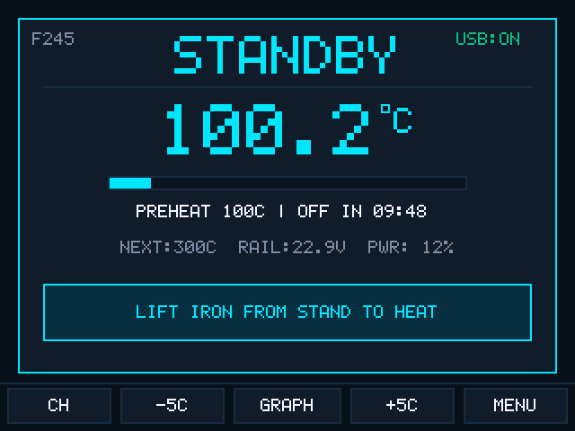
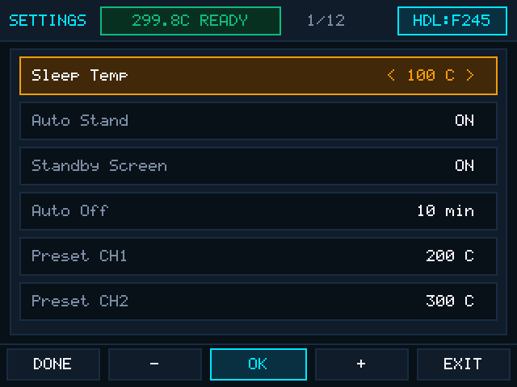

# OpenDWS-200 ⚡🪛

[](https://github.com/Daddelgreis74/OpenDWS-200/actions/workflows/build-and-release.yml)
[](LICENSE)

Alternative **open-source bare-metal firmware** and **PC Studio companion app** for the **FNIRSI DWS-200** 200 W precision soldering station (MCU: Artery `AT32F415RCT7`, ARM Cortex-M4 without hardware FPU, `144 MHz`).

> [!IMPORTANT]
> **Final Release `v1.0.0` — Closed-Loop PID Control, 3-Point Calibration & OpenDWS-200 Studio**
> On power-up, if the iron rests in the stand (`PB5 = LOW`) with a cartridge inserted, the station automatically enters **full-screen Standby (`100 °C` preheat + auto-off countdown)** and waits until you pick up the handle. If no cartridge is inserted (`PC0 > 4000`), a graphical **`NO TIP! / KEINE SPITZE!`** warning appears with a periodic alarm beep (`1.5 s`) while heating stays strictly locked out. Pressing the **power button (`PB0`/`PB1`)** saves modified settings to Flash and powers off cleanly.

---

## 📸 UI Preview (Screenshots)

| Full-Screen Standby (`100 °C` & Auto-Off) | Active Heating (`F245 PID`) |
| :---: | :---: |
|  |  |

| Live Temperature & Power Graph (`GRAPH`) | On-Screen Settings Menu (`PB4`) |
| :---: | :---: |
|  |  |

| Graphical `NO TIP!` Warning + Alarm | |
| :---: | :---: |
|  | |

---

## 🌟 Features (`v1.0.0`)

- **⚡ Auto-Stand (`PB5`), Full-Screen Standby & Auto-Off Protection:**
  - **Boot-Safe Standby & Preheat:** Powering on with the iron in the stand (`PB5 = LOW`) runs a `455 µs` short-circuit probe pulse, preheats to `100 °C`, and shows the calm full-screen standby view (`Standby Screen` can be toggled in the menu). Lifting the handle (`PB5: LOW→HIGH`) engages the full target temperature; booting outside the stand remains safely disabled at `0 W`.
  - **Configurable Auto-Off Timer (`OFF`, `5 / 10 / 15 / 30 / 60 min`, default `10 min`):** Cuts tip power completely (`0 W`) with a live countdown and alert tone when idle in the stand, preventing tip oxidation. Picking up the handle wakes it immediately.
  - **`READY` Chime (`100 ms`):** Beeps once when reaching the target temperature (`±3.0 °C`), without re-triggering during soldering load (respects `Buzzer: ON/OFF`).
  - **Graphical `NO TIP!` Warning:** Displays immediately when the thermocouple reads open (`FAULT_OPEN_TIP`, `PC0 > 4000`) with a repeating `1.5 s` alarm beep.
  - **Soft-Power Latch (`PB0`/`PB1`):** Persists settings automatically to internal Flash (`0x0803F800`) and drops `PB1 = LOW` on shutdown.

- **🖥️ Flicker-Free Aurora-Dark UI (`320 × 240`, ST7789V) & Smoothed Readout:**
  - **Flicker-Free Rendering & Calm Display Filter:** Single-pass strip rendering (`gfx_draw_badge` / sparkline / dual graph) at `10 Hz`. An adaptive smoothing filter with `±0.7 °C` hysteresis displays rock-steady rounded whole `°C` digits (while PID, live graph, and CSV logger keep full `0.1 °C` precision).
  - **Dual Temperature & Power Graph (`GRAPH`):** Toggle via `MODE/OK` (`PD2`) to plot live tip temperature (`0..480 °C`), output duty (`0..100 %`), and target setpoint (`-- SET`).
  - **On-Screen Settings Menu (`PB4`):** Sleep Temp (`OFF` / `50–250 °C`, default `100 °C`), Auto Stand `ON/OFF`, **Standby Screen `ON/OFF`**, **Auto Off (`OFF` / `5–60 min`, default `10 min`)**, Presets `CH1..3`, **3-Point Calibration (`Cal 150 / 250 / 350` per `F245` / `F210`)**, Backlight (`10–100 %`), Buzzer `ON/OFF`, USB Stream `ON/OFF`, and `Save to Flash`.

### Button Controls (Left to Right)

| Button | Pin | Main / Standby Screen | Inside Settings Menu (`PB4`) |
| :--- | :--- | :--- | :--- |
| Left (`CH / CLR`) | `PC11` | Cycle presets `CH1..CH3` or clear latched fault | Back / exit edit mode |
| 2nd Left (`<`) | `PC12` | Target `-5 °C` (long press `-25 °C`) | Scroll up / value `-` |
| Center (`MODE / OK`) | `PD2` | **Short:** Toggle Main ↔ `GRAPH` view<br>**Long:** Save to Flash (does **not** toggle heater) | Enter/confirm edit (`OK`) or toggle option |
| 4th Left (`>`) | `PB3` | Target `+5 °C` (long press `+25 °C`) | Scroll down / value `+` |
| Right (`MENU`) | `PB4` | Open settings menu | Close settings menu |

- **🔥 `100 Hz` Blanking, `91 µs` PID Control & Stock Cold-Junction Calibration (`TMR1` + `TMR2`):**
  - Verified DC blanking from `APP_DWS_200_V1.5`: `1.0 ms` after `PA2 = LOW`, `PC0` samples the clean thermocouple voltage (`alpha = 0.2` EMA) with the stock-verified **`+25.0 °C` cold-junction baseline offset** (`TIP_COLD_JUNCTION_DECI_C`) and independent **3-point calibration (`150 °C`, `250 °C`, `350 °C`)**.
  - Automatic handle detection via `PB6` + backup-domain analog mux (`PC13..PC15`) with `1.0 s` settling lockout:
    - **`F245` (`PB6 = 1`):** `200 W` profile, 5-segment LUT, max `80..90` ticks (`7.3..8.2 ms`), short-circuit cutoff `10.0 A`.
    - **`F210` (`PB6 = 0`):** `C210` LUT, hard-capped at `30` ticks (`2.73 ms`), short-circuit cutoff `15.0 A`.
- **🛡️ Multi-Layer Hardware & Software Protection:**
  - `364 µs` cycle-by-cycle overcurrent trip inside `TMR2` IRQ + `455 µs` probe pulse on arm/cartridge insertion.
  - `24 V` rail supervisor (`PA3 × 16`), open-tip cutoff (`> 4000 raw`), `30 s` sustained overload (`> 5 A`), `480 °C` hard cutoff, *Thermal Runaway Protection* (`8 s`), and `2 s` hardware watchdog.
- **🔌 USB-CDC Live Telemetry & Remote Control (`VID 0x2E3C / PID 0x5740`):**
  - Full ASCII command protocol (`HELP`, `INFO`, `STAT`, `HEAT`, `TEMP`, `PRESET`, `SLEEP`, `CAL`, `CLEAR`, `SAVE`, `STREAM`, `BL`, `BEEP`, `LED`, `REBOOT`).

---

## 💻 PC Software (`OpenDWS-200 Studio`)

The [`pc-app/`](pc-app/) directory contains **OpenDWS-200 Studio**, an Electron desktop app matching the Aurora-Dark theme with a custom 3D app/desktop icon, packaged for Windows as both an NSIS installer and a portable executable via [GitHub Releases](../../releases):

- **Direct Download:** Download `OpenDWS-200-Firmware-v*.bin`, `OpenDWS-200-Studio-Setup-v*.exe` (Windows installer), and `OpenDWS-200-Studio-Portable-v*.exe` from [GitHub Releases](../../releases).
- **Features:** Automatic USB detection & reconnect (`Auto-USB`, `VID 0x2E3C / PID 0x5740`), calm rounded KPI + high-res (`0.1 °C`) live dual-axis plotter, editable `CH1–CH3` presets synced bidirectionally with the station, 3-point tip calibration (`150 / 250 / 350 °C`), CSV data logger, raw USB console, and 1-click firmware updater (from GitHub Releases or a local `.bin` file directly to the `BOOTLOADER` drive).

---

## 🔌 Flashing & Reverting (No External Programmer Required)

1. Turn off the station using the rear mains switch.
2. Hold **MODE (`PD2`)** and connect the station to your PC with a **USB-C data cable**.
3. The USB drive `BOOTLOADER` will mount automatically.
4. Copy `OpenDWS-200-Firmware-v*.bin` (from [GitHub Releases](../../releases)) onto `BOOTLOADER` and power-cycle the station.
5. You can revert to stock firmware at any time by copying `APP_DWS_200_V1.5_250922.bin` onto `BOOTLOADER`.

---

## 📚 Documentation & Tests

- [Changelog](CHANGELOG.md)
- [Hardware Map & Pinout](docs/hardware-map.md)
- [Phase-2 Control & Stock Firmware Analysis](docs/phase2-control-analysis.md)
- [USB-CDC Protocol Reference](docs/usb-protocol.md)

```bash
# Host unit tests (ASan + UBSan)
make test

# Build ARM firmware + verify binary (CI uses clang + lld + llvm)
make firmware
make verify-bin

# Generate UI preview screenshots
make screenshots
```

---

## 📜 License

[MIT License](LICENSE) — Copyright (c) 2026 Daddelgreis74.
